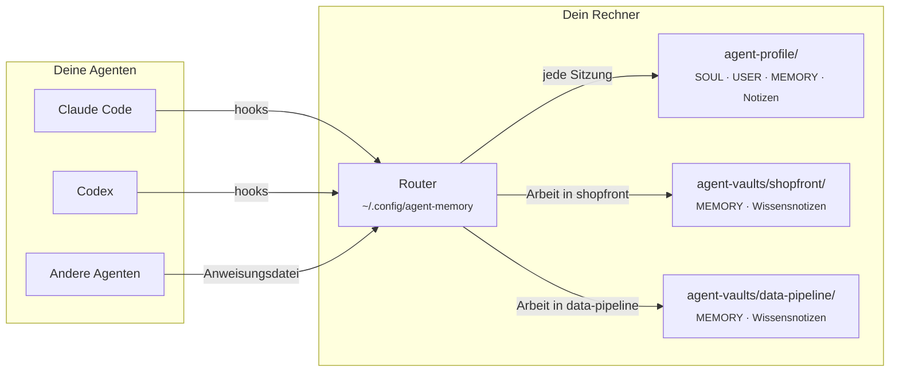
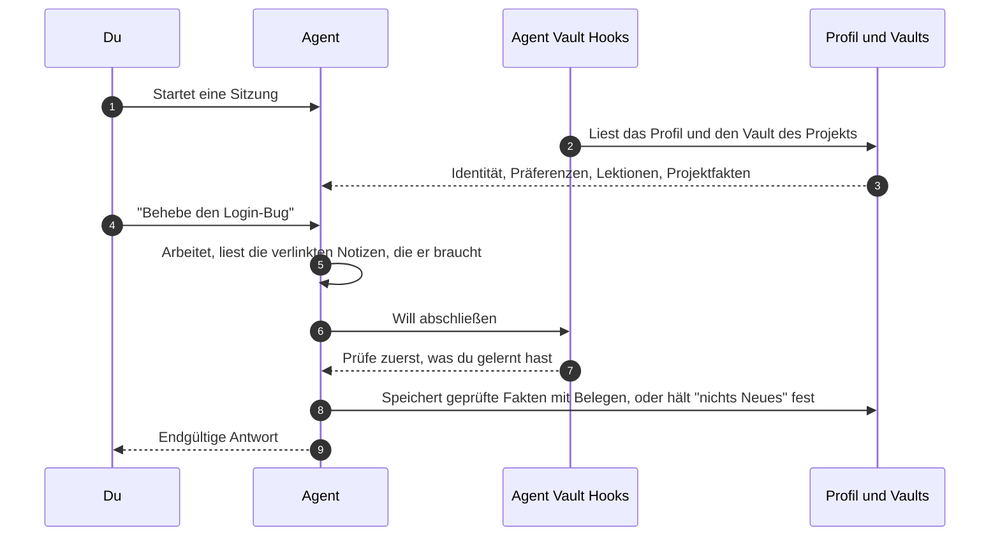

<div align="center">


# Agent Vault

**Ein gemeinsames Gedächtnis für alle Coding-Agenten, die du nutzt, plus ein eigenes Gedächtnis für jedes Projekt.**

[](https://github.com/AlexMakesC0de/agent-vault/actions/workflows/tests.yml)
[](LICENSE)


[English](README.md) · [简体中文](README.zh-CN.md) · [Español](README.es.md) · [日本語](README.ja.md) · [한국어](README.ko.md) · [Português (Brasil)](README.pt-BR.md) · **Deutsch**

Dies ist eine Übersetzung. Bei Abweichungen gilt die englische Fassung, [README.md](README.md).

</div>

<p align="center">
  <picture>
    <source media="(prefers-color-scheme: dark)" srcset="docs/assets/viewer-dark.png">
    
  </picture>
  <br>
  <sub>Die schreibgeschützte Gedächtnisseite, hier mit Demodaten.</sub>
</p>

Coding-Agenten vergessen zwischen zwei Sitzungen alles, und jeder Agent führt seine eigenen Notizen in seinem eigenen Format. Agent Vault gibt Claude Code, Codex und jedem anderen Agenten, der eine Anweisungsdatei liest, **dasselbe Gedächtnis**: wer du bist und wie du arbeiten willst, die Lektionen, die überall gelten, und die Fakten des Projekts, in dem du gerade bist. Es ist einfaches Markdown auf deiner Festplatte, jede Änderung behält ihre Belege und ihren Verlauf, und nichts verlässt deinen Rechner.

## Inhalt

- [Highlights](#highlights)
- [So funktioniert es](#so-funktioniert-es)
- [Schnellstart](#schnellstart)
- [Lass deinen Agenten die Einrichtung übernehmen](#lass-deinen-agenten-die-einrichtung-übernehmen)
- [Dein Gedächtnis ansehen](#dein-gedächtnis-ansehen)
- [Befehle für den Alltag](#befehle-für-den-alltag)
- [Projektwissen](#projektwissen)
- [Weitere Geräte, Teams und andere Agenten](#weitere-geräte-teams-und-andere-agenten)
- [FAQ](#faq)
- [Mitwirken](#mitwirken)
- [Lizenz](#lizenz)

## Highlights

- **Ein Profil für alle Agenten.** Claude Code und Codex laden über Hooks dieselbe Identität, dieselben Präferenzen und dieselben allgemeinen Lektionen. Andere Agenten nutzen dieselben Dateien über ihre Anweisungsdatei.
- **Ein Vault pro Projekt.** Projektfakten werden nur geladen, wenn du in diesem Projekt arbeitest, sodass Details eines Projekts nie in ein anderes gelangen. Vaults liegen außerhalb deiner Repositories, es sei denn, du teilst einen bewusst mit deinem Team.
- **Kleine Kerne, verlinkte Notizen.** Jeder Kern hat ein Zeichenlimit, damit er in jede Sitzung passt. Details kommen in verlinkte Themennotizen, die Agenten nur lesen, wenn eine Aufgabe sie braucht.
- **Belege und Verlauf.** Jeder gespeicherte Fakt hält seine Quelle und seine Art fest (explicit, observed oder inferred), und jede Änderung behält den vorherigen Wert. Schreibvorgänge auf veraltetem Stand werden abgelehnt, statt sich gegenseitig zu überschreiben.
- **Verlässliche Rückblicke.** Bevor ein Agent fertig ist, fordern ihn die Hooks auf, zu prüfen, was er gelernt hat, und diesen Rückblick festzuhalten, auch wenn sich nichts geändert hat.
- **Suche, Diagnose und Viewer.** Volltextsuche mit Ranking über dein gesamtes Gedächtnis, ein schreibgeschützter Health-Check und eine statische Seite, die alles auf einen Blick zeigt.
- **Lokal und ohne Abhängigkeiten.** Nur die Python-Standardbibliothek. Kein Server, kein API-Schlüssel, keine Datenbank, die du betreiben musst.

## So funktioniert es

Dein Gedächtnis besteht aus ein paar Ordnern mit Markdown. Ein kleiner Router, einmal pro Rechner installiert, entscheidet, was jede Agentensitzung zu sehen bekommt.



Das Profil wird immer geladen. Ein Projekt-Vault wird geladen, wenn du das Projekt nennst oder in seinem Ordner arbeitest, und seine Fakten bleiben in diesem Vault. Gelerntes fließt auf demselben Weg zurück:



## Schnellstart

Du brauchst **Python 3.11+**, **Git** und Claude Code, Codex oder beides. Unter Windows installierst du Git for Windows (es enthält Git Bash); WSL ist nicht nötig.

**1. Schalte das automatische Gedächtnis von Claude aus** (für Claude Code). Es ist ein separater Speicher und würde mit Agent Vault konkurrieren. [Sichere vorher deine Notizen und schalte es dann aus](docs/claude-auto-memory.md).

**2. Hol dir die Tools und erstelle dein Profil.** Führe das in dem Ordner aus, in dem `agent-vault` und `agent-profile` liegen sollen. Nutze `python3` unter macOS und Linux, und lass `--codex-hooks` weg, wenn du nur Claude verwendest.

```bash
git clone https://github.com/AlexMakesC0de/agent-vault.git
cd agent-vault
python scripts/agent-memory.py --profile ../agent-profile init-profile
python scripts/project-memory-router.py install --profile ../agent-profile --codex-hooks
```

Die Installation behält deine bestehenden Client-Einstellungen bei und sichert sie vorher. Sie legt weder ein Konto noch ein Repository an.

**3. Füge ein Projekt hinzu.** Lass `--workspace` auf ein bestehendes Git-Projekt zeigen und ersetze `MyApp` und `myapp` durch dessen Namen.

```bash
python scripts/setup-vault.py --vault ../agent-vaults/myapp --name MyApp
python scripts/project-memory-router.py register --id myapp --name MyApp --root ../agent-vaults/myapp --workspace /full/path/to/MyApp
```

Das Projekt-Repository wird nicht verändert. Wiederhole das für jedes Projekt; alle teilen sich dein eines Profil. Wenn du einen Vault nicht mehr nutzen willst, führe `project-memory-router.py unregister --id myapp` aus; die Dateien bleiben erhalten.

**4. Prüfe es.** Starte deinen Client neu und vertraue den Hooks, wenn er danach fragt. Frag in einem neuen Chat:

> Welches zentrale Profil und welches Projektgedächtnis von MyApp hast du geladen? Zeig mir ihre Pfade und Revisionen.

Führe dann den Health-Check aus, der nichts verändert:

```bash
python ~/.config/agent-memory/router.py doctor
```

<details>
<summary><b>Wo alles liegt</b></summary>

```text
Your chosen folder/
├── agent-vault/            The tools, cloned from this repository
├── agent-profile/          Your memory, created by init-profile
│   ├── SOUL.md             Who your agent is (one identity for all agents)
│   ├── USER.md             Your preferences
│   ├── MEMORY.md           Lessons that apply across projects
│   └── notes/              Detail too long for the cores, read on demand
├── agent-vaults/
│   └── myapp/
│       ├── MEMORY.md       Facts about MyApp only
│       └── docs/knowledge/ Linked topic notes
└── MyApp/                  Your project; Agent Vault adds nothing to it

~/.config/agent-memory/     Installed router, search index, viewer page
```

</details>

## Lass deinen Agenten die Einrichtung übernehmen

Du willst die Befehle nicht selbst eintippen? Füge das in Claude Code oder Codex ein, in einem leeren Ordner, in dem die Tools liegen sollen:

```text
Richte Agent Vault (https://github.com/AlexMakesC0de/agent-vault) auf diesem Rechner ein.
Lies die README.md und folge dem Abschnitt Quick start genau, mit python unter Windows
und python3 auf anderen Systemen.
- Zeig mir vor Schritt 1, was die Anleitung zum automatischen Gedächtnis von Claude
  ändern wird, und warte auf mein Okay.
- Frag mich, welche meiner Git-Projekte du hinzufügen sollst, und nach ihren
  vollständigen Pfaden. Rate nicht.
- Frag mich, ob ich Codex nutze, bevor du --codex-hooks hinzufügst.
- Verändere kein Projekt-Repository.
- Führe zum Schluss router.py doctor aus und zeig mir die Ausgabe.
```

Nach der Installation weiß der Agent bereits, wie er das Gedächtnis nutzt: Das Installationsprogramm fügt die Anweisungen in deinen Client ein.

## Dein Gedächtnis ansehen

```bash
python ~/.config/agent-memory/view.py --open
```

Das schreibt eine HTML-Seite nach `~/.config/agent-memory/view.html` und öffnet sie: dein Profil mit seinen Größenanzeigen, jeder registrierte Projekt-Vault, deine Notizen zu Personen und die neuesten Änderungen. Abgeleitete Einträge, die noch nicht geladen werden, haben einen gestrichelten Rahmen.

Die Seite ist **schreibgeschützt und lädt nichts aus dem Netz**. Um etwas zu ändern, klickst du auf einer Karte auf **Copy request** und fügst den Text in den Chat mit deinem Agenten ein; der Agent nimmt die Änderung über die Memory-CLI vor, mit Verlauf. Weil die Seite dein privates Profil enthält, weigert sich der Viewer, sie in einen Vault- oder Projektordner zu schreiben.

## Befehle für den Alltag

Selbst ausführen musst du sie selten: Agenten bekommen sie über ihren Sitzungskontext. Sie stehen hier, damit du weißt, was es gibt.

| Was | Befehl |
| --- | --- |
| Herausfinden, wo etwas festgehalten ist | `python ~/.config/agent-memory/router.py search merge jobs --project myapp` |
| Installation und Zustand des Gedächtnisses prüfen | `python ~/.config/agent-memory/router.py doctor --fetch` |
| Dein Gedächtnis als Seite anzeigen | `python ~/.config/agent-memory/view.py --open` |
| Ausgeben, was eine Sitzung laden würde | `python ~/.config/agent-memory/router.py context --prompt MyApp` |
| Registrierte Projekte auflisten | `python ~/.config/agent-memory/router.py list` |
| Einen Fakt speichern (mit Beleg und aktueller Revision) | `python ~/.config/agent-memory/agent-memory.py --root PATH update --help` |
| Die verlinkten Notizen eines Projekts prüfen | `python ~/.config/agent-memory/agent-memory.py --root PATH check-knowledge` |

[Alle Gedächtnisbefehle](docs/maintenance.md)

## Projektwissen

Ein Projekt-Vault hat zwei Ebenen. `MEMORY.md` ist ein kleiner Kern, der in jeder Sitzung geladen wird, für Regeln, die für fast jede Aufgabe gelten. Alles andere liegt als Themennotizen in `docs/knowledge/`: ein Thema pro Notiz, gruppiert unter Bereichskarten und verlinkt, wo sie aufeinander verweisen. Agenten beginnen bei der Karte und öffnen nur die Notizen, die eine Aufgabe braucht, sodass die Kosten pro Sitzung gleich bleiben, während das Projekt wächst.

Um die Notizen für ein Projekt aufzubauen, bitte deinen Agenten, den Skill **vault-knowledge** zu verwenden. Er sieht sich das Repository an, schreibt die Karten, füllt die Notizen und prüft jeden Link mit `check-knowledge`. Hat ein Vault weniger als fünf Notizen, erinnert der Sitzungskontext den Agenten daran, das anzubieten.

[Obsidian](https://obsidian.md) ist optional: Öffne dein Profil und jeden Vault als separate Obsidian-Vaults, um durch die Links zu navigieren. Agenten lesen das Markdown direkt, Obsidian muss also nicht laufen.

## Weitere Geräte, Teams und andere Agenten

- **Ein weiteres Gerät.** Das Gedächtnis synchronisiert sich nicht von selbst. Leg dein Profil in ein eigenes privates Git-Repository, mach jeden Vault zu einem eigenen Repository und folge dann der [Geräteanleitung](docs/devices.md).
- **Ein Vault für das ganze Team.** Leg den Vault mit `setup-vault.py --root /path/to/MyApp --name MyApp` in das Projekt-Repository (für Codex `--codex-hooks` ergänzen) und registriere ihn ohne `--workspace`. Dadurch werden die Memory-Skripte, Hooks und Notizen ins Repository committet, und alle, die es klonen, laden sie.
- **Andere Agenten.** Jeder Agent, der eine Anweisungsdatei liest und einen Shell-Befehl ausführen kann, kann dasselbe Gedächtnis nutzen: Übergib seine Datei an `install --instructions PATH`.
- **Ältere Vaults.** Ein Projekt mit einer generierten `SOUL.md` aus einer früheren Version muss zuerst [migriert](docs/migration.md) werden.

## FAQ

<details>
<summary><b>Verlässt mein Gedächtnis meinen Rechner?</b></summary>

Nein. Die Tools lesen und schreiben lokale Dateien und stellen von sich aus keine Netzwerkanfragen; die einzige Ausnahme ist `doctor --fetch`, das `git fetch` auf dem Klon des Toolkits ausführt. Die Agenten, die du nutzt, sehen das Gedächtnis, das sie bekommen, wie bei jeder Anweisungsdatei. Halte also Geheimnisse und Kundendaten daraus fern.
</details>

<details>
<summary><b>Warum ist die Größe der Kerne begrenzt?</b></summary>

Dein Profil und der Kern des aktuellen Projekts werden dem Agenten in einer einzigen Hook-Nachricht geschickt, die Claude Code auf 10,000 Zeichen begrenzt. Die Limits (SOUL 1,500, USER 2,000, MEMORY 2,200) halten beide darin. Bei 85% warnen dich die Tools, damit Details in verlinkte Notizen wandern, bevor ein Speichern abgelehnt wird.
</details>

<details>
<summary><b>Warum Markdown-Dateien und keine Datenbank?</b></summary>

Du kannst jede Änderung in einem Pull Request lesen, vergleichen und prüfen, die Dateien überdauern jedes Tool, und die Verlaufsprüfungen bauen auf ihnen auf. Die Suche nutzt einen SQLite-Index, der aus dem Markdown neu aufgebaut wird, daher kannst du ihn jederzeit gefahrlos löschen.
</details>

<details>
<summary><b>Ersetzt es das eigene Gedächtnis von Claude?</b></summary>

Ja, wenn du eine einzige verlässliche Quelle willst. [Schalte das automatische Gedächtnis von Claude aus](docs/claude-auto-memory.md), damit die beiden nicht konkurrieren. `CLAUDE.md`-Dateien funktionieren weiter wie bisher.
</details>

<details>
<summary><b>Was, wenn ein Agent etwas Falsches speichert?</b></summary>

Jede Änderung behält den vorherigen Wert im Verlauf des Speichers, und Einträge werden nur stillgelegt, nie gelöscht. Bitte den Agenten, den Eintrag zu korrigieren oder stillzulegen, oder nutze die Memory-CLI selbst.
</details>

## Dokumentation

[Gedächtnisbefehle](docs/maintenance.md) · [Geräteanleitung](docs/devices.md) · [Migration](docs/migration.md) · [Architektur und Wiederherstellung](docs/architecture.md) · [Automatisches Gedächtnis von Claude](docs/claude-auto-memory.md)

## Mitwirken

Fehlerberichte, Ideen und Pull Requests sind willkommen. In [CONTRIBUTING.md](CONTRIBUTING.md) findest du das Entwicklungs-Setup, die Testsuite und die wenigen Regeln, denen jede Änderung folgt. Ein Sicherheitsproblem meldest du über [SECURITY.md](SECURITY.md), nicht über ein Issue.

## Danksagung

Die Aufteilung in Identität, Nutzerpräferenzen und Gedächtnis ist von [Hermes](https://github.com/NousResearch/hermes-agent) inspiriert. Es wurde kein Code aus dem Originalprojekt übernommen.

## Lizenz

[MIT](LICENSE)
