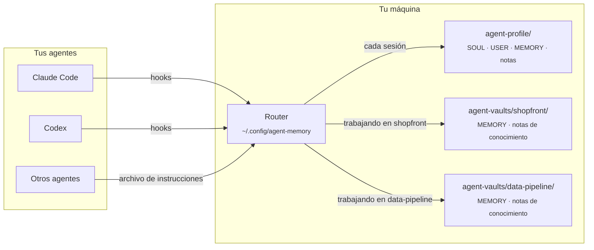
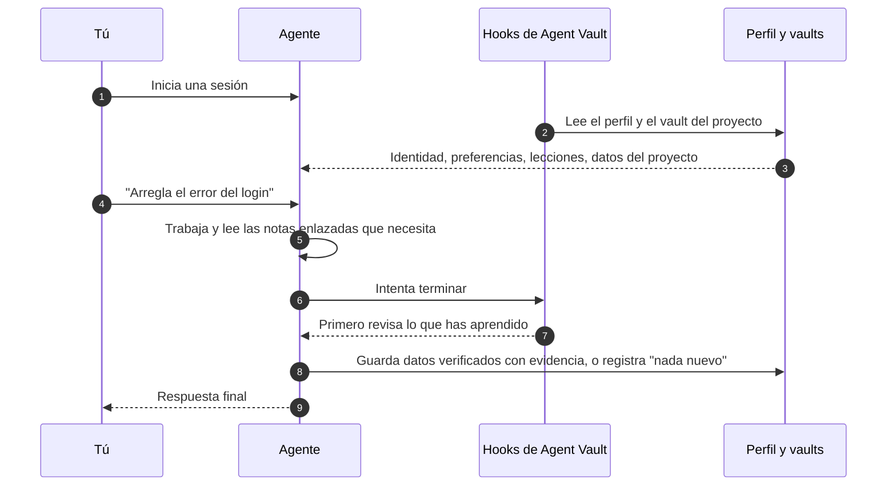

<div align="center">


# Agent Vault

**Una memoria compartida para todos los agentes de programación que usas, y una memoria aparte para cada proyecto.**

[](https://github.com/AlexMakesC0de/agent-vault/actions/workflows/tests.yml)
[](LICENSE)


[English](README.md) · [简体中文](README.zh-CN.md) · **Español** · [日本語](README.ja.md)

Esta es una traducción. Si hay diferencias, la versión en inglés, [README.md](README.md), es la referencia.

</div>

<p align="center">
  <picture>
    <source media="(prefers-color-scheme: dark)" srcset="docs/assets/viewer-dark.png">
    
  </picture>
  <br>
  <sub>La página de memoria de solo lectura, mostrada aquí con datos de demostración.</sub>
</p>

Los agentes de programación lo olvidan todo entre sesiones, y cada uno guarda sus propias notas en su propio formato. Agent Vault da a Claude Code, a Codex y a cualquier otro agente que lea un archivo de instrucciones **la misma memoria**: quién eres y cómo te gusta trabajar, las lecciones que sirven en todas partes y los datos del proyecto en el que estés. Es Markdown plano en tu disco, cada cambio conserva su evidencia y su historial, y nada sale de tu máquina.

## Contenido

- [Puntos clave](#puntos-clave)
- [Cómo funciona](#cómo-funciona)
- [Inicio rápido](#inicio-rápido)
- [Deja que tu agente lo configure](#deja-que-tu-agente-lo-configure)
- [Consulta tu memoria](#consulta-tu-memoria)
- [Comandos habituales](#comandos-habituales)
- [Conocimiento del proyecto](#conocimiento-del-proyecto)
- [Más dispositivos, equipos y otros agentes](#más-dispositivos-equipos-y-otros-agentes)
- [Preguntas frecuentes](#preguntas-frecuentes)
- [Cómo contribuir](#cómo-contribuir)
- [Licencia](#licencia)

## Puntos clave

- **Un perfil para todos los agentes.** Claude Code y Codex cargan la misma identidad, las mismas preferencias y las mismas lecciones generales mediante hooks. Los demás agentes usan los mismos archivos a través de su archivo de instrucciones.
- **Un vault por proyecto.** Los datos de un proyecto solo se cargan cuando trabajas en él, así que los detalles de un proyecto nunca se filtran a otro. Los vaults viven fuera de tus repositorios, salvo que decidas compartir uno con tu equipo.
- **Núcleos pequeños, notas enlazadas.** Cada núcleo tiene un límite de caracteres para que quepa en todas las sesiones. El detalle va a notas temáticas enlazadas que los agentes solo leen cuando una tarea las necesita.
- **Evidencia e historial.** Cada dato guardado registra su origen y su tipo (explicit, observed o inferred), y cada cambio conserva el valor anterior. Las escrituras basadas en una versión desactualizada se rechazan en lugar de sobrescribirse entre sí.
- **Revisiones fiables.** Antes de que un agente termine, los hooks le piden que revise lo que ha aprendido y que deje constancia de esa revisión, aunque no haya cambiado nada.
- **Búsqueda, diagnóstico y visor.** Búsqueda de texto completo con ranking en toda tu memoria, una comprobación de estado de solo lectura y una página estática que lo muestra todo de un vistazo.
- **Local y sin dependencias.** Solo la biblioteca estándar de Python. Sin servidor, sin clave de API y sin base de datos que mantener.

## Cómo funciona

Tu memoria son unas pocas carpetas de Markdown. Un pequeño router, que se instala una vez por máquina, decide qué ve cada sesión de agente.



El perfil se carga siempre. Un vault de proyecto se carga cuando nombras el proyecto o trabajas dentro de su carpeta, y sus datos se quedan en ese vault. Lo aprendido vuelve por el mismo camino:



## Inicio rápido

Necesitas **Python 3.11+**, **Git** y Claude Code, Codex o ambos. En Windows, instala Git for Windows (incluye Git Bash); no hace falta WSL.

**1. Desactiva la memoria automática de Claude** (usuarios de Claude Code). Es un almacén independiente y competiría con Agent Vault. Antes, [haz una copia de tus notas y desactívala](docs/claude-auto-memory.md).

**2. Descarga las herramientas y crea tu perfil.** Ejecuta esto en la carpeta donde quieras tener `agent-vault` y `agent-profile`. Usa `python3` en macOS y Linux, y quita `--codex-hooks` si solo usas Claude.

```bash
git clone https://github.com/AlexMakesC0de/agent-vault.git
cd agent-vault
python scripts/agent-memory.py --profile ../agent-profile init-profile
python scripts/project-memory-router.py install --profile ../agent-profile --codex-hooks
```

La instalación conserva la configuración actual de tus clientes y hace una copia de seguridad antes. No crea ninguna cuenta ni ningún repositorio.

**3. Añade un proyecto.** Apunta `--workspace` a un proyecto Git existente y cambia `MyApp` y `myapp` por su nombre.

```bash
python scripts/setup-vault.py --vault ../agent-vaults/myapp --name MyApp
python scripts/project-memory-router.py register --id myapp --name MyApp --root ../agent-vaults/myapp --workspace /full/path/to/MyApp
```

El repositorio del proyecto no se modifica. Repite el proceso para cada proyecto; todos comparten tu único perfil. Para dejar de usar un vault, ejecuta `project-memory-router.py unregister --id myapp`; los archivos se conservan.

**4. Compruébalo.** Reinicia tu cliente y confía en los hooks cuando te lo pida. En un chat nuevo, pregunta:

> ¿Qué perfil central y qué memoria del proyecto MyApp has cargado? Muestra sus rutas y revisiones.

Después ejecuta la comprobación de estado, que no cambia nada:

```bash
python ~/.config/agent-memory/router.py doctor
```

<details>
<summary><b>Dónde queda cada cosa</b></summary>

```text
Your chosen folder/
├── agent-vault/            The tools, cloned from this repository
├── agent-profile/          Your memory, created by init-profile
│   ├── SOUL.md             Who your agent is (one identity for all agents)
│   ├── USER.md             Your preferences
│   ├── MEMORY.md           Lessons that apply across projects
│   └── notes/              Detail too long for the cores, read on demand
├── agent-vaults/
│   └── myapp/
│       ├── MEMORY.md       Facts about MyApp only
│       └── docs/knowledge/ Linked topic notes
└── MyApp/                  Your project; Agent Vault adds nothing to it

~/.config/agent-memory/     Installed router, search index, viewer page
```

</details>

## Deja que tu agente lo configure

¿Prefieres no escribir los comandos? Pega esto en Claude Code o en Codex, desde una carpeta vacía donde deban quedar las herramientas:

```text
Instala Agent Vault (https://github.com/AlexMakesC0de/agent-vault) en esta máquina.
Lee su README.md y sigue la sección Quick start al pie de la letra, usando python
en Windows y python3 en los demás sistemas.
- Antes del paso 1, muéstrame qué va a cambiar la guía de la memoria automática
  de Claude y espera a que te dé el visto bueno.
- Pregúntame qué proyectos Git quiero añadir y sus rutas completas. No las adivines.
- Pregúntame si uso Codex antes de añadir --codex-hooks.
- No modifiques ningún repositorio de proyecto.
- Termina ejecutando router.py doctor y enseñándome su salida.
```

Una vez instalado, el agente ya sabe cómo usar la memoria: el instalador añade las instrucciones a tu cliente.

## Consulta tu memoria

```bash
python ~/.config/agent-memory/view.py --open
```

Esto genera una página HTML en `~/.config/agent-memory/view.html` y la abre: tu perfil con sus medidores de tamaño, cada vault de proyecto registrado, tus notas sobre personas y los cambios más recientes. Las entradas inferidas que todavía no se cargan aparecen con borde discontinuo.

La página es **de solo lectura y no carga nada de la red**. Para cambiar algo, pulsa **Copy request** en una tarjeta y pega el texto en el chat con tu agente; el agente hace el cambio con la CLI de memoria, con historial. Como la página contiene tu perfil privado, el visor se niega a escribirla dentro de un vault o de una carpeta de proyecto.

## Comandos habituales

Rara vez los ejecutarás tú: los agentes los reciben en el contexto de su sesión. Están aquí para que sepas qué existe.

| Qué | Comando |
| --- | --- |
| Encontrar dónde está registrado algo | `python ~/.config/agent-memory/router.py search merge jobs --project myapp` |
| Comprobar el estado de la instalación y de la memoria | `python ~/.config/agent-memory/router.py doctor --fetch` |
| Ver tu memoria como página | `python ~/.config/agent-memory/view.py --open` |
| Mostrar lo que cargaría una sesión | `python ~/.config/agent-memory/router.py context --prompt MyApp` |
| Listar los proyectos registrados | `python ~/.config/agent-memory/router.py list` |
| Guardar un dato (con evidencia y la revisión actual) | `python ~/.config/agent-memory/agent-memory.py --root PATH update --help` |
| Comprobar las notas enlazadas de un proyecto | `python ~/.config/agent-memory/agent-memory.py --root PATH check-knowledge` |

[Todos los comandos de memoria](docs/maintenance.md)

## Conocimiento del proyecto

Un vault de proyecto tiene dos capas. `MEMORY.md` es un núcleo pequeño que se carga en cada sesión, para las reglas que se aplican a casi cualquier tarea. Todo lo demás vive en `docs/knowledge/` como notas temáticas: un tema por nota, agrupadas bajo mapas de área y enlazadas cuando se mencionan entre sí. Los agentes empiezan por el mapa y abren solo las notas que necesita la tarea, así que el coste de cada sesión se mantiene estable aunque el proyecto crezca.

Para crear las notas de un proyecto, pide a tu agente que use la skill **vault-knowledge**. Recorre el repositorio, escribe los mapas, rellena las notas y verifica cada enlace con `check-knowledge`. Cuando un vault tiene menos de cinco notas, el contexto de la sesión le recuerda al agente que lo ofrezca.

[Obsidian](https://obsidian.md) es opcional: abre tu perfil y cada vault como vaults de Obsidian independientes para navegar por los enlaces. Los agentes leen el Markdown directamente, así que no hace falta que esté abierto.

## Más dispositivos, equipos y otros agentes

- **Otro dispositivo.** La memoria no se sincroniza sola. Guarda tu perfil en un repositorio Git privado propio, haz que cada vault sea su propio repositorio y sigue la [guía de dispositivos](docs/devices.md).
- **Un vault para todo el equipo.** Coloca el vault dentro del repositorio del proyecto con `setup-vault.py --root /path/to/MyApp --name MyApp` (añade `--codex-hooks` para Codex) y regístralo sin `--workspace`. Así se confirman en el repositorio los scripts de memoria, los hooks y las notas, y todo el que lo clone los carga.
- **Otros agentes.** Cualquier agente que lea un archivo de instrucciones y pueda ejecutar un comando de shell puede usar la misma memoria: pasa su archivo a `install --instructions PATH`.
- **Vaults antiguos.** Un proyecto con un `SOUL.md` generado por una versión anterior necesita una [migración](docs/migration.md) primero.

## Preguntas frecuentes

<details>
<summary><b>¿Mi memoria sale de mi máquina?</b></summary>

No. Las herramientas leen y escriben archivos locales y no hacen peticiones de red por su cuenta; la única excepción es `doctor --fetch`, que ejecuta `git fetch` en el clon del kit de herramientas. Los agentes que usas ven la memoria que se les da, como con cualquier archivo de instrucciones, así que no incluyas en ella secretos ni datos de clientes.
</details>

<details>
<summary><b>¿Por qué los núcleos tienen un tamaño limitado?</b></summary>

Tu perfil y el núcleo del proyecto actual se envían al agente en un único mensaje de hook, que Claude Code limita a 10,000 caracteres. Los límites (SOUL 1,500, USER 2,000, MEMORY 2,200) mantienen ambos dentro de ese margen. Al llegar al 85% las herramientas te avisan, para que el detalle pase a notas enlazadas antes de que se rechace un guardado.
</details>

<details>
<summary><b>¿Por qué archivos Markdown y no una base de datos?</b></summary>

Puedes leer, comparar y revisar cada cambio en una pull request, los archivos sobreviven a cualquier herramienta y las comprobaciones del historial se basan en ellos. La búsqueda usa un índice SQLite que se reconstruye a partir del Markdown, así que borrarlo siempre es seguro.
</details>

<details>
<summary><b>¿Sustituye a la memoria propia de Claude?</b></summary>

Sí, si quieres una única fuente de verdad. [Desactiva la memoria automática de Claude](docs/claude-auto-memory.md) para que las dos no compitan. Los archivos `CLAUDE.md` siguen funcionando como antes.
</details>

<details>
<summary><b>¿Y si un agente guarda algo incorrecto?</b></summary>

Cada cambio conserva el valor anterior en el historial del almacén, y las entradas solo se retiran, nunca se borran. Pide al agente que corrija o retire la entrada, o usa tú mismo la CLI de memoria.
</details>

## Documentación

[Comandos de memoria](docs/maintenance.md) · [Guía de dispositivos](docs/devices.md) · [Migración](docs/migration.md) · [Arquitectura y recuperación](docs/architecture.md) · [Memoria automática de Claude](docs/claude-auto-memory.md)

## Cómo contribuir

Los informes de errores, las ideas y las pull requests son bienvenidos. Lee [CONTRIBUTING.md](CONTRIBUTING.md) para conocer la configuración de desarrollo, la batería de pruebas y las pocas reglas que sigue cada cambio. Para informar de un problema de seguridad, sigue [SECURITY.md](SECURITY.md) en lugar de abrir una issue.

## Agradecimientos

La separación entre identidad, preferencias del usuario y memoria se inspiró en [Hermes](https://github.com/NousResearch/hermes-agent). No se ha copiado código de ese proyecto.

## Licencia

[MIT](LICENSE)
