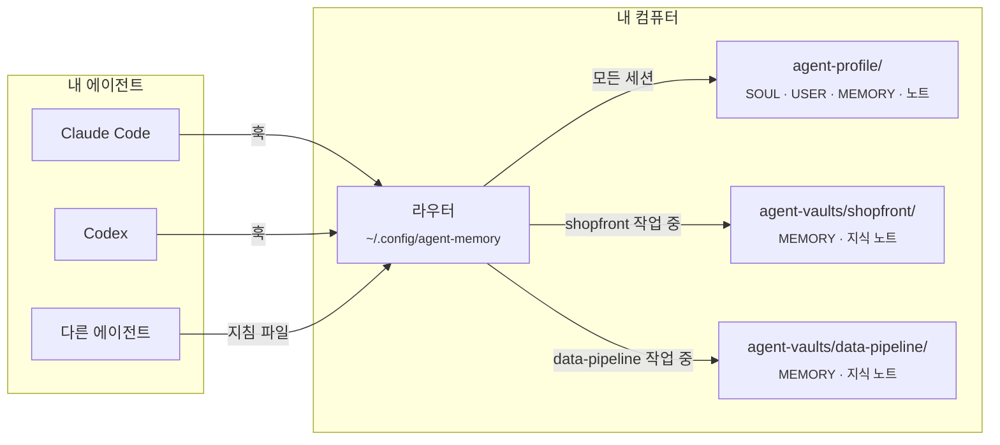
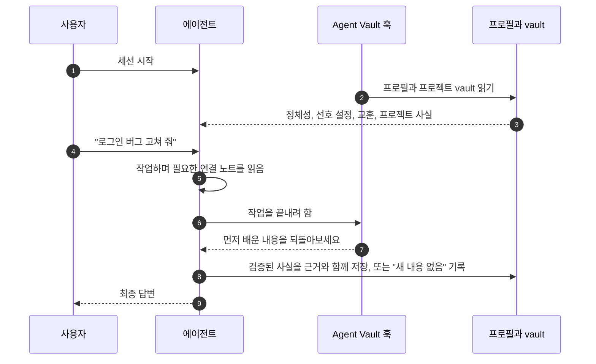

<div align="center">


# Agent Vault

**사용하는 모든 코딩 에이전트가 함께 쓰는 하나의 메모리, 그리고 프로젝트마다 따로 두는 메모리.**

[](https://github.com/AlexMakesC0de/agent-vault/actions/workflows/tests.yml)
[](LICENSE)


[English](README.md) · [简体中文](README.zh-CN.md) · [Español](README.es.md) · [日本語](README.ja.md) · **한국어** · [Português (Brasil)](README.pt-BR.md) · [Deutsch](README.de.md)

이 문서는 번역본입니다. 내용이 다를 경우 영어 원문인 [README.md](README.md)가 기준입니다.

</div>

<p align="center">
  <picture>
    <source media="(prefers-color-scheme: dark)" srcset="docs/assets/viewer-dark.png">
    
  </picture>
  <br>
  <sub>읽기 전용 메모리 페이지입니다. 여기서는 데모 데이터로 표시했습니다.</sub>
</p>

코딩 에이전트는 세션이 끝날 때마다 모든 것을 잊어버리고, 에이전트마다 자기 형식으로 따로 메모를 남깁니다. Agent Vault는 Claude Code, Codex, 그리고 지침 파일을 읽는 모든 에이전트에 **같은 메모리**를 제공합니다. 당신이 누구이고 어떻게 일하고 싶은지, 어디서나 통하는 교훈, 그리고 지금 작업 중인 프로젝트의 사실이 담깁니다. 내용은 디스크에 있는 평범한 Markdown이고, 모든 변경에 근거와 이력이 남으며, 어떤 것도 내 컴퓨터 밖으로 나가지 않습니다.

## 목차

- [주요 특징](#주요-특징)
- [작동 방식](#작동-방식)
- [빠른 시작](#빠른-시작)
- [에이전트에게 설정 맡기기](#에이전트에게-설정-맡기기)
- [메모리 확인하기](#메모리-확인하기)
- [자주 쓰는 명령](#자주-쓰는-명령)
- [프로젝트 지식](#프로젝트-지식)
- [다른 기기, 팀, 다른 에이전트](#다른-기기-팀-다른-에이전트)
- [자주 묻는 질문](#자주-묻는-질문)
- [기여하기](#기여하기)
- [라이선스](#라이선스)

## 주요 특징

- **하나의 프로필을 모든 에이전트에서.** Claude Code와 Codex는 훅을 통해 같은 정체성, 선호 설정, 일반 교훈을 불러옵니다. 다른 에이전트는 각자의 지침 파일을 통해 같은 파일을 사용합니다.
- **프로젝트마다 하나의 vault.** 프로젝트의 사실은 그 프로젝트에서 작업할 때만 불러오므로, 한 프로젝트의 세부 정보가 다른 프로젝트로 새어 나가지 않습니다. 팀과 공유하기로 하지 않는 한 vault는 저장소 밖에 둡니다.
- **작은 코어, 연결된 노트.** 각 코어에는 글자 수 제한이 있어 모든 세션에 들어갑니다. 자세한 내용은 연결된 주제 노트에 두고, 에이전트는 작업에 필요할 때만 그 노트를 읽습니다.
- **근거와 이력.** 저장되는 모든 사실은 출처와 종류(explicit, observed, inferred)를 기록하고, 모든 변경은 이전 값을 남깁니다. 오래된 버전을 기준으로 한 쓰기는 서로 덮어쓰는 대신 거부됩니다.
- **믿을 수 있는 회고.** 에이전트가 작업을 마치기 전에 훅이 배운 내용을 되돌아보고 그 회고를 기록하라고 요청합니다. 바뀐 것이 없어도 마찬가지입니다.
- **검색, 진단, 뷰어.** 전체 메모리를 대상으로 한 순위 기반 전문 검색, 읽기 전용 상태 점검, 그리고 모든 것을 한눈에 보여 주는 정적 페이지를 제공합니다.
- **로컬 전용, 의존성 없음.** Python 표준 라이브러리만 사용합니다. 서버도, API 키도, 운영할 데이터베이스도 필요 없습니다.

## 작동 방식

메모리는 Markdown이 들어 있는 몇 개의 폴더입니다. 컴퓨터마다 한 번 설치하는 작은 라우터가 각 에이전트 세션에 무엇을 보여 줄지 결정합니다.



프로필은 항상 불러옵니다. 프로젝트 vault는 프로젝트 이름을 말하거나 그 폴더 안에서 작업할 때 불러오며, 그 사실은 해당 vault 안에만 머뭅니다. 배운 내용도 같은 경로로 돌아갑니다.



## 빠른 시작

**Python 3.11+**, **Git**, 그리고 Claude Code나 Codex(또는 둘 다)가 필요합니다. Windows에서는 Git for Windows(Git Bash 포함)를 설치하세요. WSL은 필요 없습니다.

**1. Claude 자동 메모리를 끕니다** (Claude Code 사용자). 별도의 저장소라서 Agent Vault와 충돌합니다. 먼저 [노트를 백업하고 끄세요](docs/claude-auto-memory.md).

**2. 도구를 받고 프로필을 만듭니다.** `agent-vault`와 `agent-profile`을 둘 폴더에서 아래 명령을 실행하세요. macOS와 Linux에서는 `python3`를 사용하고, Claude만 쓴다면 `--codex-hooks`는 빼세요.

```bash
git clone https://github.com/AlexMakesC0de/agent-vault.git
cd agent-vault
python scripts/agent-memory.py --profile ../agent-profile init-profile
python scripts/project-memory-router.py install --profile ../agent-profile --codex-hooks
```

설치는 기존 클라이언트 설정을 유지하며, 먼저 백업해 둡니다. 계정이나 저장소는 만들지 않습니다.

**3. 프로젝트를 추가합니다.** `--workspace`에 기존 Git 프로젝트를 지정하고, `MyApp`과 `myapp`을 그 프로젝트 이름으로 바꾸세요.

```bash
python scripts/setup-vault.py --vault ../agent-vaults/myapp --name MyApp
python scripts/project-memory-router.py register --id myapp --name MyApp --root ../agent-vaults/myapp --workspace /full/path/to/MyApp
```

프로젝트 저장소는 변경되지 않습니다. 프로젝트마다 반복하세요. 모든 프로젝트가 하나의 프로필을 공유합니다. vault 사용을 멈추려면 `project-memory-router.py unregister --id myapp`을 실행하세요. 파일은 그대로 남습니다.

**4. 확인합니다.** 클라이언트를 다시 시작하고, 요청이 오면 훅을 신뢰하세요. 새 채팅에서 이렇게 물어보세요.

> 어떤 중앙 프로필과 MyApp 프로젝트 메모리를 불러왔나요? 각각의 경로와 리비전을 보여 주세요.

그다음 상태 점검을 실행하세요. 아무것도 변경하지 않습니다.

```bash
python ~/.config/agent-memory/router.py doctor
```

<details>
<summary><b>각 파일의 위치</b></summary>

```text
Your chosen folder/
├── agent-vault/            The tools, cloned from this repository
├── agent-profile/          Your memory, created by init-profile
│   ├── SOUL.md             Who your agent is (one identity for all agents)
│   ├── USER.md             Your preferences
│   ├── MEMORY.md           Lessons that apply across projects
│   └── notes/              Detail too long for the cores, read on demand
├── agent-vaults/
│   └── myapp/
│       ├── MEMORY.md       Facts about MyApp only
│       └── docs/knowledge/ Linked topic notes
└── MyApp/                  Your project; Agent Vault adds nothing to it

~/.config/agent-memory/     Installed router, search index, viewer page
```

</details>

## 에이전트에게 설정 맡기기

명령을 직접 입력하고 싶지 않나요? 도구를 둘 빈 폴더에서 아래 내용을 Claude Code나 Codex에 붙여 넣으세요.

```text
이 컴퓨터에 Agent Vault(https://github.com/AlexMakesC0de/agent-vault)를 설정해 주세요.
README.md를 읽고 Quick start 섹션을 그대로 따르세요. Windows에서는 python,
그 밖의 환경에서는 python3를 사용하세요.
- 1단계 전에 Claude 자동 메모리 가이드가 무엇을 바꾸는지 보여 주고
  내가 승인할 때까지 기다리세요.
- 어떤 Git 프로젝트를 추가할지와 그 전체 경로를 물어보세요. 추측하지 마세요.
- --codex-hooks를 추가하기 전에 내가 Codex를 쓰는지 물어보세요.
- 어떤 프로젝트 저장소도 변경하지 마세요.
- 마지막으로 router.py doctor를 실행하고 그 출력을 보여 주세요.
```

설치가 끝나면 에이전트는 이미 메모리 사용법을 알고 있습니다. 설치 프로그램이 클라이언트에 지침을 추가하기 때문입니다.

## 메모리 확인하기

```bash
python ~/.config/agent-memory/view.py --open
```

이 명령은 HTML 페이지 하나를 `~/.config/agent-memory/view.html`에 만들고 엽니다. 크기 미터가 있는 프로필, 등록된 모든 프로젝트 vault, 사람에 관한 노트, 최근 변경 내용이 표시됩니다. 아직 불러오지 않은 추론 항목은 점선 테두리로 표시됩니다.

이 페이지는 **읽기 전용이며 네트워크에서 아무것도 불러오지 않습니다**. 무언가를 바꾸려면 카드에서 **Copy request**를 누르고 그 텍스트를 에이전트 채팅에 붙여 넣으세요. 에이전트가 메모리 CLI로 이력과 함께 변경합니다. 페이지에 비공개 프로필이 담겨 있으므로, 뷰어는 이 페이지를 vault나 프로젝트 폴더 안에 쓰는 것을 거부합니다.

## 자주 쓰는 명령

직접 실행할 일은 거의 없습니다. 에이전트가 세션 컨텍스트에서 받기 때문입니다. 어떤 명령이 있는지 알 수 있도록 여기에 정리했습니다.

| 용도 | 명령 |
| --- | --- |
| 어떤 내용이 어디에 기록됐는지 찾기 | `python ~/.config/agent-memory/router.py search merge jobs --project myapp` |
| 설치와 메모리 상태 점검 | `python ~/.config/agent-memory/router.py doctor --fetch` |
| 메모리를 페이지로 보기 | `python ~/.config/agent-memory/view.py --open` |
| 세션이 불러올 내용 출력 | `python ~/.config/agent-memory/router.py context --prompt MyApp` |
| 등록된 프로젝트 목록 | `python ~/.config/agent-memory/router.py list` |
| 사실 저장(근거와 현재 리비전 포함) | `python ~/.config/agent-memory/agent-memory.py --root PATH update --help` |
| 프로젝트의 연결 노트 점검 | `python ~/.config/agent-memory/agent-memory.py --root PATH check-knowledge` |

[모든 메모리 명령](docs/maintenance.md)

## 프로젝트 지식

프로젝트 vault는 두 계층으로 이루어집니다. `MEMORY.md`는 매 세션 불러오는 작은 코어로, 거의 모든 작업에 적용되는 규칙을 담습니다. 나머지는 모두 `docs/knowledge/`에 주제 노트로 둡니다. 노트 하나에 주제 하나를 담고, 영역별 맵 아래에 묶으며, 서로 언급하는 곳에서 연결합니다. 에이전트는 맵에서 시작해 작업에 필요한 노트만 열기 때문에, 프로젝트가 커져도 세션마다 드는 비용은 일정하게 유지됩니다.

프로젝트의 노트를 만들려면 에이전트에게 **vault-knowledge** 스킬을 사용하라고 요청하세요. 이 스킬은 저장소를 살펴보고, 맵을 작성하고, 노트를 채운 뒤, `check-knowledge`로 모든 링크를 검증합니다. vault의 노트가 다섯 개보다 적으면 세션 컨텍스트가 에이전트에게 이 작업을 제안하라고 알려 줍니다.

[Obsidian](https://obsidian.md)은 선택 사항입니다. 프로필과 각 vault를 별도의 Obsidian vault로 열면 링크를 따라 탐색할 수 있습니다. 에이전트는 Markdown을 직접 읽으므로 Obsidian을 실행해 둘 필요는 없습니다.

## 다른 기기, 팀, 다른 에이전트

- **다른 기기.** 메모리는 저절로 동기화되지 않습니다. 프로필은 본인의 비공개 Git 저장소에 두고 각 vault도 별도의 저장소로 만든 다음, [기기 가이드](docs/devices.md)를 따르세요.
- **팀 전체를 위한 vault.** `setup-vault.py --root /path/to/MyApp --name MyApp`으로 vault를 프로젝트 저장소 안에 두고(Codex를 쓴다면 `--codex-hooks` 추가), `--workspace` 없이 등록하세요. 그러면 메모리 스크립트, 훅, 노트가 저장소에 커밋되고, 저장소를 클론하는 모든 사람이 이를 불러옵니다.
- **다른 에이전트.** 지침 파일을 읽고 셸 명령을 실행할 수 있는 에이전트라면 같은 메모리를 사용할 수 있습니다. 그 에이전트의 파일을 `install --instructions PATH`에 넘기세요.
- **이전 버전의 vault.** 이전 버전에서 생성된 `SOUL.md`가 있는 프로젝트는 먼저 [마이그레이션](docs/migration.md)해야 합니다.

## 자주 묻는 질문

<details>
<summary><b>내 메모리가 컴퓨터 밖으로 나가나요?</b></summary>

아니요. 도구는 로컬 파일을 읽고 쓰며 자체적으로 네트워크 요청을 보내지 않습니다. 유일한 예외는 `doctor --fetch`로, 툴킷 클론에서 `git fetch`를 실행합니다. 사용하는 에이전트는 다른 지침 파일과 마찬가지로 전달받은 메모리를 볼 수 있으므로, 비밀 정보와 고객 데이터는 넣지 마세요.
</details>

<details>
<summary><b>코어 크기는 왜 제한되나요?</b></summary>

프로필과 현재 프로젝트의 코어는 하나의 훅 메시지로 에이전트에 전달되는데, Claude Code는 이 메시지를 10,000자로 제한합니다. 제한값(SOUL 1,500, USER 2,000, MEMORY 2,200)은 둘 다 그 안에 들어가도록 정한 것입니다. 85%에 이르면 도구가 경고하므로, 저장이 거부되기 전에 세부 내용을 연결 노트로 옮길 수 있습니다.
</details>

<details>
<summary><b>왜 데이터베이스가 아니라 Markdown 파일인가요?</b></summary>

모든 변경을 pull request에서 읽고, diff로 비교하고, 리뷰할 수 있습니다. 파일은 어떤 도구보다 오래 남고, 이력 검사도 이 파일을 기반으로 합니다. 검색은 Markdown으로부터 다시 만드는 SQLite 인덱스를 사용하므로, 인덱스를 지워도 항상 안전합니다.
</details>

<details>
<summary><b>Claude 자체 메모리를 대체하나요?</b></summary>

네, 신뢰할 수 있는 단일 출처를 원한다면 그렇습니다. 둘이 충돌하지 않도록 [Claude 자동 메모리를 끄세요](docs/claude-auto-memory.md). `CLAUDE.md` 파일은 예전처럼 계속 작동합니다.
</details>

<details>
<summary><b>에이전트가 잘못된 내용을 저장하면 어떻게 되나요?</b></summary>

모든 변경은 저장소 이력에 이전 값을 남기고, 항목은 폐기될 뿐 지워지지 않습니다. 에이전트에게 항목을 수정하거나 폐기하라고 요청하거나, 메모리 CLI를 직접 사용하세요.
</details>

## 문서

[메모리 명령](docs/maintenance.md) · [기기 가이드](docs/devices.md) · [마이그레이션](docs/migration.md) · [아키텍처와 복구](docs/architecture.md) · [Claude 자동 메모리](docs/claude-auto-memory.md)

## 기여하기

버그 보고, 아이디어, pull request를 환영합니다. 개발 환경 설정, 테스트 스위트, 모든 변경이 따르는 몇 가지 규칙은 [CONTRIBUTING.md](CONTRIBUTING.md)를 읽어 보세요. 보안 문제를 보고하려면 이슈를 여는 대신 [SECURITY.md](SECURITY.md)를 따르세요.

## 감사의 말

정체성, 사용자 선호 설정, 메모리를 나누는 구조는 [Hermes](https://github.com/NousResearch/hermes-agent)에서 영감을 받았습니다. 원본 프로젝트의 코드는 복사하지 않았습니다.

## 라이선스

[MIT](LICENSE)
