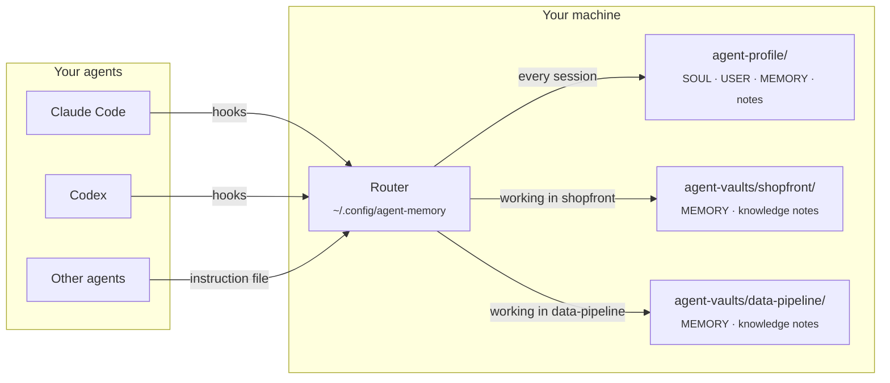
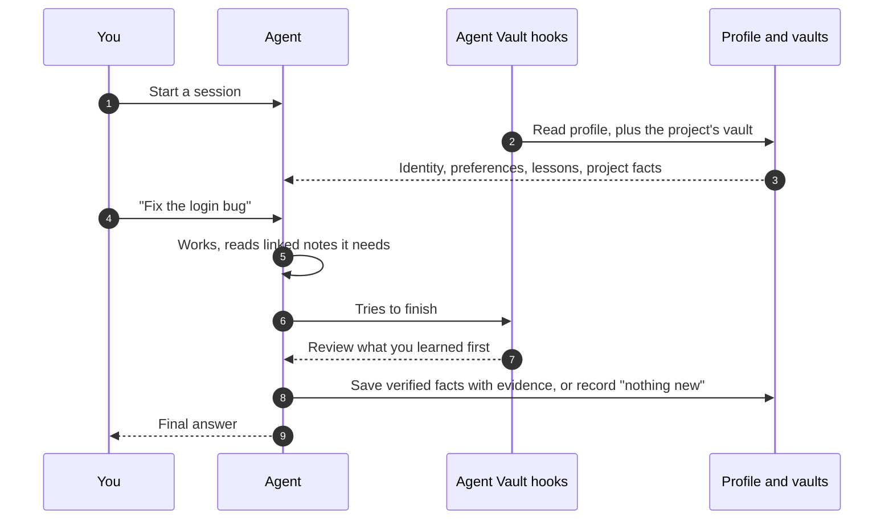

<div align="center">


# Agent Vault

**One shared memory for every coding agent you use, plus a separate memory for each project.**

[](https://github.com/AlexMakesC0de/agent-vault/actions/workflows/tests.yml)
[](LICENSE)


**English** · [简体中文](README.zh-CN.md) · [Español](README.es.md) · [日本語](README.ja.md)

</div>

<p align="center">
  <picture>
    <source media="(prefers-color-scheme: dark)" srcset="docs/assets/viewer-dark.png">
    
  </picture>
  <br>
  <sub>The read-only memory page, shown here with demo data.</sub>
</p>

Coding agents forget everything between sessions, and each agent keeps its own notes in its own format. Agent Vault gives Claude Code, Codex and any other agent that reads an instruction file **the same memory**: who you are and how you like to work, the lessons that apply everywhere, and the facts of whichever project you are in. It is plain Markdown on your disk, every change keeps its evidence and history, and nothing leaves your machine.

## Contents

- [Highlights](#highlights)
- [How it works](#how-it-works)
- [Quick start](#quick-start)
- [Let your agent set it up](#let-your-agent-set-it-up)
- [See your memory](#see-your-memory)
- [Everyday commands](#everyday-commands)
- [Project knowledge](#project-knowledge)
- [More devices, teams and other agents](#more-devices-teams-and-other-agents)
- [FAQ](#faq)
- [Contributing](#contributing)
- [License](#license)

## Highlights

- **One profile, every agent.** Claude Code and Codex load the same identity, preferences and general lessons through hooks. Other agents use the same files through their instruction file.
- **A vault per project.** Project facts load only when you work in that project, so one project's details never leak into another. Vaults live outside your repositories unless you choose to share one with your team.
- **Small cores, linked notes.** Each core has a character limit so it fits in every session. Detail goes into linked topic notes that agents read only when a task needs them.
- **Evidence and history.** Every saved fact records its source and kind (explicit, observed or inferred), and every change keeps the previous value. Stale writers are refused instead of overwriting each other.
- **Reviews you can rely on.** Before an agent finishes, the hooks ask it to review what it learned and record that review, even when nothing changed.
- **Search, a doctor and a viewer.** Ranked full-text search across all your memory, a read-only health check, and a static page that shows everything at a glance.
- **Local and dependency-free.** Python standard library only. No server, no API key, no database to run.

## How it works

Your memory is a few folders of Markdown. A small router, installed once per machine, decides what each agent session sees.



The profile always loads. A project vault loads when you name the project or work inside its folder, and its facts stay in that vault. Learning flows back the same way:



## Quick start

You need **Python 3.11+**, **Git**, and Claude Code, Codex or both. On Windows, install Git for Windows (it includes Git Bash); WSL is not needed.

**1. Turn off Claude's auto memory** (Claude Code users). It is a separate store and would compete with Agent Vault. [Back up your notes and turn it off](docs/claude-auto-memory.md) first.

**2. Get the tools and create your profile.** Run this in the folder where `agent-vault` and `agent-profile` should live. Use `python3` on macOS and Linux, and leave out `--codex-hooks` if you only use Claude.

```bash
git clone https://github.com/AlexMakesC0de/agent-vault.git
cd agent-vault
python scripts/agent-memory.py --profile ../agent-profile init-profile
python scripts/project-memory-router.py install --profile ../agent-profile --codex-hooks
```

Install keeps your existing client settings and backs them up first. It does not create any account or repository.

**3. Add a project.** Point `--workspace` at an existing Git project; change `MyApp` and `myapp` to its name.

```bash
python scripts/setup-vault.py --vault ../agent-vaults/myapp --name MyApp
python scripts/project-memory-router.py register --id myapp --name MyApp --root ../agent-vaults/myapp --workspace /full/path/to/MyApp
```

The project repository is not changed. Repeat for each project; all of them share your one profile. To stop using a vault, run `project-memory-router.py unregister --id myapp`; the files stay.

**4. Check it.** Restart your client and trust the hooks when it asks. In a fresh chat, ask:

> Which central profile and MyApp project memory did you load? Show their paths and revisions.

Then run the health check, which changes nothing:

```bash
python ~/.config/agent-memory/router.py doctor
```

<details>
<summary><b>Where everything lives</b></summary>

```text
Your chosen folder/
├── agent-vault/            The tools, cloned from this repository
├── agent-profile/          Your memory, created by init-profile
│   ├── SOUL.md             Who your agent is (one identity for all agents)
│   ├── USER.md             Your preferences
│   ├── MEMORY.md           Lessons that apply across projects
│   └── notes/              Detail too long for the cores, read on demand
├── agent-vaults/
│   └── myapp/
│       ├── MEMORY.md       Facts about MyApp only
│       └── docs/knowledge/ Linked topic notes
└── MyApp/                  Your project; Agent Vault adds nothing to it

~/.config/agent-memory/     Installed router, search index, viewer page
```

</details>

## Let your agent set it up

Prefer not to type the commands? Paste this into Claude Code or Codex, in an empty folder where the tools should live:

```text
Set up Agent Vault (https://github.com/AlexMakesC0de/agent-vault) on this machine.
Read its README.md and follow the Quick start exactly, using python on Windows
and python3 elsewhere.
- Before step 1, show me what the Claude auto memory guide will change and wait
  for my go-ahead.
- Ask me which of my Git projects to add, and their full paths. Do not guess.
- Ask whether I use Codex before adding --codex-hooks.
- Do not change any project repository.
- Finish by running router.py doctor and showing me its output.
```

Once it is installed, the agent already knows how to use the memory: the installer adds the instructions to your client.

## See your memory

```bash
python ~/.config/agent-memory/view.py --open
```

This writes one HTML page to `~/.config/agent-memory/view.html` and opens it: your profile with its size meters, every registered project vault, your people notes and the latest changes. Inferred entries that are not loaded yet are drawn with a dashed border.

The page is **read-only and loads nothing from the network**. To change something, press **Copy request** on a card and paste the text into your agent chat; the agent makes the change through the memory CLI, with history. Because the page contains your private profile, the viewer refuses to write it into a vault or project folder.

## Everyday commands

You rarely run these yourself: agents get them in their session context. They are here so you know what exists.

| What | Command |
| --- | --- |
| Find where something is recorded | `python ~/.config/agent-memory/router.py search merge jobs --project myapp` |
| Check the install and memory health | `python ~/.config/agent-memory/router.py doctor --fetch` |
| Show your memory as a page | `python ~/.config/agent-memory/view.py --open` |
| Print what a session would load | `python ~/.config/agent-memory/router.py context --prompt MyApp` |
| List registered projects | `python ~/.config/agent-memory/router.py list` |
| Save a fact (with evidence and the current revision) | `python ~/.config/agent-memory/agent-memory.py --root PATH update --help` |
| Check a project's linked notes | `python ~/.config/agent-memory/agent-memory.py --root PATH check-knowledge` |

[All memory commands](docs/maintenance.md)

## Project knowledge

A project vault has two layers. `MEMORY.md` is a small core loaded every session, for rules that apply to almost every task. Everything else lives in `docs/knowledge/` as topic notes: one topic per note, grouped under area maps and linked where they mention each other. Agents start at the map and open only the notes a task needs, so the cost of each session stays flat as the project grows.

To build the notes for a project, ask your agent to use the **vault-knowledge** skill. It surveys the repository, writes the maps, fills the notes and verifies every link with `check-knowledge`. When a vault has fewer than five notes, the session context reminds the agent to offer this.

[Obsidian](https://obsidian.md) is optional: open your profile and each vault as separate Obsidian vaults to browse the links. Agents read the Markdown directly, so it does not need to be running.

## More devices, teams and other agents

- **Another device.** Memory does not sync by itself. Put your profile in your own private Git repository and make each vault its own repository, then follow the [device guide](docs/devices.md).
- **A vault for the whole team.** Put the vault inside the project repository with `setup-vault.py --root /path/to/MyApp --name MyApp` (add `--codex-hooks` for Codex) and register it without `--workspace`. This commits the memory scripts, hooks and notes to the repository, and everyone who clones it loads them.
- **Other agents.** Any agent that reads an instruction file and can run a shell command can use the same memory: pass its file to `install --instructions PATH`.
- **Older vaults.** A project with a generated `SOUL.md` from an earlier version needs [migrating](docs/migration.md) first.

## FAQ

<details>
<summary><b>Does my memory leave my machine?</b></summary>

No. The tools read and write local files and make no network requests of their own; the one exception is `doctor --fetch`, which runs `git fetch` on the toolkit clone. The agents you use see the memory they are given, as with any instruction file, so keep secrets and customer data out of it.
</details>

<details>
<summary><b>Why are the cores limited in size?</b></summary>

Your profile and the current project's core are sent to the agent in one hook message, which Claude Code caps at 10,000 characters. The limits (SOUL 1,500, USER 2,000, MEMORY 2,200) keep both inside it. At 85% the tools warn you, so detail moves into linked notes before a save is refused.
</details>

<details>
<summary><b>Why Markdown files and not a database?</b></summary>

You can read, diff and review every change in a pull request, the files outlive any tool, and the history checks are built on them. Search uses a SQLite index rebuilt from the Markdown, so deleting it is always safe.
</details>

<details>
<summary><b>Does it replace Claude's own memory?</b></summary>

Yes, if you want one source of truth. [Turn Claude's auto memory off](docs/claude-auto-memory.md) so the two do not compete. `CLAUDE.md` files keep working as before.
</details>

<details>
<summary><b>What if an agent saves something wrong?</b></summary>

Every change keeps the previous value in the store's history, and entries are only retired, never erased. Ask the agent to correct or retire the entry, or use the memory CLI yourself.
</details>

## Documentation

[Memory commands](docs/maintenance.md) · [Device guide](docs/devices.md) · [Migration](docs/migration.md) · [Architecture and recovery](docs/architecture.md) · [Claude auto memory](docs/claude-auto-memory.md)

## Contributing

Bug reports, ideas and pull requests are welcome. Read [CONTRIBUTING.md](CONTRIBUTING.md) for the development setup, the test suite and the few rules every change follows. To report a security problem, follow [SECURITY.md](SECURITY.md) instead of opening an issue.

## Acknowledgements

The split between identity, user preferences and memory was inspired by [Hermes](https://github.com/NousResearch/hermes-agent). No upstream code is copied.

## License

[MIT](LICENSE)
