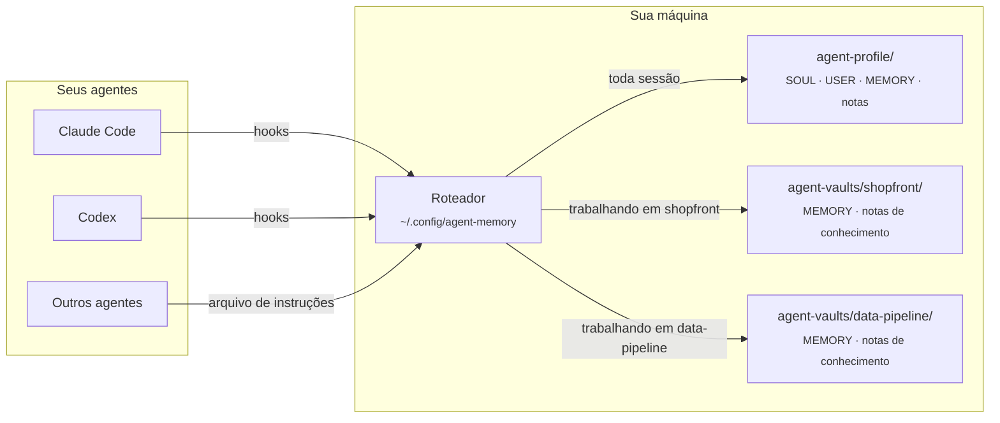
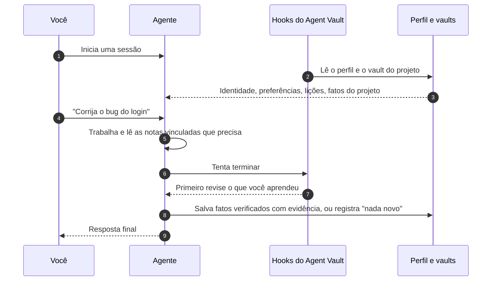

<div align="center">


# Agent Vault

**Uma memória compartilhada para todos os agentes de programação que você usa, e uma memória separada para cada projeto.**

[](https://github.com/AlexMakesC0de/agent-vault/actions/workflows/tests.yml)
[](LICENSE)


[English](README.md) · [简体中文](README.zh-CN.md) · [Español](README.es.md) · [日本語](README.ja.md) · [한국어](README.ko.md) · **Português (Brasil)** · [Deutsch](README.de.md)

Esta é uma tradução. Se houver diferenças, vale a versão em inglês, [README.md](README.md).

</div>

<p align="center">
  <picture>
    <source media="(prefers-color-scheme: dark)" srcset="docs/assets/viewer-dark.png">
    
  </picture>
  <br>
  <sub>A página de memória somente leitura, mostrada aqui com dados de demonstração.</sub>
</p>

Agentes de programação esquecem tudo entre uma sessão e outra, e cada agente guarda as próprias anotações no próprio formato. O Agent Vault dá ao Claude Code, ao Codex e a qualquer outro agente que leia um arquivo de instruções **a mesma memória**: quem você é e como gosta de trabalhar, as lições que valem em qualquer lugar e os fatos do projeto em que você estiver. É Markdown puro no seu disco, cada alteração guarda a evidência e o histórico, e nada sai da sua máquina.

## Conteúdo

- [Destaques](#destaques)
- [Como funciona](#como-funciona)
- [Início rápido](#início-rápido)
- [Deixe seu agente configurar tudo](#deixe-seu-agente-configurar-tudo)
- [Veja sua memória](#veja-sua-memória)
- [Comandos do dia a dia](#comandos-do-dia-a-dia)
- [Conhecimento do projeto](#conhecimento-do-projeto)
- [Mais dispositivos, equipes e outros agentes](#mais-dispositivos-equipes-e-outros-agentes)
- [Perguntas frequentes](#perguntas-frequentes)
- [Como contribuir](#como-contribuir)
- [Licença](#licença)

## Destaques

- **Um perfil para todos os agentes.** O Claude Code e o Codex carregam a mesma identidade, as mesmas preferências e as mesmas lições gerais por meio de hooks. Os outros agentes usam os mesmos arquivos pelo próprio arquivo de instruções.
- **Um vault por projeto.** Os fatos de um projeto só são carregados quando você trabalha nele, então os detalhes de um projeto nunca vazam para outro. Os vaults ficam fora dos seus repositórios, a menos que você decida compartilhar um com sua equipe.
- **Núcleos pequenos, notas vinculadas.** Cada núcleo tem um limite de caracteres para caber em todas as sessões. Os detalhes vão para notas temáticas vinculadas, que os agentes só leem quando uma tarefa precisa delas.
- **Evidência e histórico.** Cada fato salvo registra a origem e o tipo (explicit, observed ou inferred), e cada alteração guarda o valor anterior. Gravações feitas a partir de uma versão desatualizada são recusadas em vez de sobrescreverem umas às outras.
- **Revisões confiáveis.** Antes de um agente terminar, os hooks pedem que ele revise o que aprendeu e registre essa revisão, mesmo quando nada mudou.
- **Busca, diagnóstico e visualizador.** Busca de texto completo com ranking em toda a sua memória, uma verificação de saúde somente leitura e uma página estática que mostra tudo de relance.
- **Local e sem dependências.** Só a biblioteca padrão do Python. Sem servidor, sem chave de API e sem banco de dados para manter.

## Como funciona

Sua memória são algumas pastas de Markdown. Um pequeno roteador, instalado uma vez por máquina, decide o que cada sessão de agente vê.



O perfil é sempre carregado. Um vault de projeto é carregado quando você cita o projeto ou trabalha dentro da pasta dele, e os fatos dele ficam nesse vault. O que foi aprendido volta pelo mesmo caminho:



## Início rápido

Você precisa de **Python 3.11+**, **Git** e do Claude Code, do Codex ou dos dois. No Windows, instale o Git for Windows (ele inclui o Git Bash); o WSL não é necessário.

**1. Desative a memória automática do Claude** (usuários do Claude Code). Ela é um armazenamento separado e competiria com o Agent Vault. Antes, [faça backup das suas notas e desative-a](docs/claude-auto-memory.md).

**2. Baixe as ferramentas e crie seu perfil.** Execute isto na pasta onde `agent-vault` e `agent-profile` devem ficar. Use `python3` no macOS e no Linux, e remova `--codex-hooks` se você só usa o Claude.

```bash
git clone https://github.com/AlexMakesC0de/agent-vault.git
cd agent-vault
python scripts/agent-memory.py --profile ../agent-profile init-profile
python scripts/project-memory-router.py install --profile ../agent-profile --codex-hooks
```

A instalação mantém as configurações atuais dos seus clientes e faz backup delas antes. Ela não cria nenhuma conta nem nenhum repositório.

**3. Adicione um projeto.** Aponte `--workspace` para um projeto Git existente e troque `MyApp` e `myapp` pelo nome dele.

```bash
python scripts/setup-vault.py --vault ../agent-vaults/myapp --name MyApp
python scripts/project-memory-router.py register --id myapp --name MyApp --root ../agent-vaults/myapp --workspace /full/path/to/MyApp
```

O repositório do projeto não é alterado. Repita para cada projeto; todos compartilham o seu único perfil. Para parar de usar um vault, execute `project-memory-router.py unregister --id myapp`; os arquivos continuam lá.

**4. Confira.** Reinicie o cliente e confie nos hooks quando ele pedir. Em um chat novo, pergunte:

> Qual perfil central e qual memória do projeto MyApp você carregou? Mostre os caminhos e as revisões.

Depois execute a verificação de saúde, que não altera nada:

```bash
python ~/.config/agent-memory/router.py doctor
```

<details>
<summary><b>Onde fica cada coisa</b></summary>

```text
Your chosen folder/
├── agent-vault/            The tools, cloned from this repository
├── agent-profile/          Your memory, created by init-profile
│   ├── SOUL.md             Who your agent is (one identity for all agents)
│   ├── USER.md             Your preferences
│   ├── MEMORY.md           Lessons that apply across projects
│   └── notes/              Detail too long for the cores, read on demand
├── agent-vaults/
│   └── myapp/
│       ├── MEMORY.md       Facts about MyApp only
│       └── docs/knowledge/ Linked topic notes
└── MyApp/                  Your project; Agent Vault adds nothing to it

~/.config/agent-memory/     Installed router, search index, viewer page
```

</details>

## Deixe seu agente configurar tudo

Prefere não digitar os comandos? Cole isto no Claude Code ou no Codex, a partir de uma pasta vazia onde as ferramentas devem ficar:

```text
Configure o Agent Vault (https://github.com/AlexMakesC0de/agent-vault) nesta máquina.
Leia o README.md dele e siga a seção Quick start à risca, usando python no Windows
e python3 nos outros sistemas.
- Antes do passo 1, me mostre o que o guia da memória automática do Claude vai
  alterar e espere minha confirmação.
- Me pergunte quais projetos Git adicionar e os caminhos completos deles. Não tente adivinhar.
- Me pergunte se eu uso o Codex antes de adicionar --codex-hooks.
- Não altere nenhum repositório de projeto.
- Termine executando router.py doctor e me mostrando a saída.
```

Depois de instalado, o agente já sabe usar a memória: o instalador adiciona as instruções ao seu cliente.

## Veja sua memória

```bash
python ~/.config/agent-memory/view.py --open
```

Isso gera uma página HTML em `~/.config/agent-memory/view.html` e a abre: seu perfil com os medidores de tamanho, cada vault de projeto registrado, suas notas sobre pessoas e as alterações mais recentes. Entradas inferidas que ainda não são carregadas aparecem com borda tracejada.

A página é **somente leitura e não carrega nada da rede**. Para mudar algo, clique em **Copy request** em um cartão e cole o texto no chat com o seu agente; o agente faz a alteração pela CLI de memória, com histórico. Como a página contém o seu perfil privado, o visualizador se recusa a gravá-la dentro de um vault ou de uma pasta de projeto.

## Comandos do dia a dia

Raramente você mesmo vai executá-los: os agentes os recebem no contexto da sessão. Eles estão aqui para você saber o que existe.

| O quê | Comando |
| --- | --- |
| Descobrir onde algo está registrado | `python ~/.config/agent-memory/router.py search merge jobs --project myapp` |
| Verificar a saúde da instalação e da memória | `python ~/.config/agent-memory/router.py doctor --fetch` |
| Ver sua memória como página | `python ~/.config/agent-memory/view.py --open` |
| Mostrar o que uma sessão carregaria | `python ~/.config/agent-memory/router.py context --prompt MyApp` |
| Listar os projetos registrados | `python ~/.config/agent-memory/router.py list` |
| Salvar um fato (com evidência e a revisão atual) | `python ~/.config/agent-memory/agent-memory.py --root PATH update --help` |
| Verificar as notas vinculadas de um projeto | `python ~/.config/agent-memory/agent-memory.py --root PATH check-knowledge` |

[Todos os comandos de memória](docs/maintenance.md)

## Conhecimento do projeto

Um vault de projeto tem duas camadas. `MEMORY.md` é um núcleo pequeno carregado em toda sessão, para regras que valem para quase qualquer tarefa. Todo o resto fica em `docs/knowledge/` como notas temáticas: um tema por nota, agrupadas sob mapas de área e vinculadas onde uma menciona a outra. Os agentes começam pelo mapa e abrem só as notas de que a tarefa precisa, então o custo de cada sessão continua estável à medida que o projeto cresce.

Para criar as notas de um projeto, peça ao seu agente para usar a skill **vault-knowledge**. Ela percorre o repositório, escreve os mapas, preenche as notas e verifica cada link com `check-knowledge`. Quando um vault tem menos de cinco notas, o contexto da sessão lembra o agente de oferecer isso.

O [Obsidian](https://obsidian.md) é opcional: abra seu perfil e cada vault como vaults separados do Obsidian para navegar pelos links. Os agentes leem o Markdown diretamente, então ele não precisa estar aberto.

## Mais dispositivos, equipes e outros agentes

- **Outro dispositivo.** A memória não sincroniza sozinha. Coloque seu perfil em um repositório Git privado seu, transforme cada vault em um repositório próprio e siga o [guia de dispositivos](docs/devices.md).
- **Um vault para a equipe inteira.** Coloque o vault dentro do repositório do projeto com `setup-vault.py --root /path/to/MyApp --name MyApp` (adicione `--codex-hooks` para o Codex) e registre-o sem `--workspace`. Isso faz commit dos scripts de memória, dos hooks e das notas no repositório, e todo mundo que o clonar passa a carregá-los.
- **Outros agentes.** Qualquer agente que leia um arquivo de instruções e consiga executar um comando de shell pode usar a mesma memória: passe o arquivo dele para `install --instructions PATH`.
- **Vaults antigos.** Um projeto com um `SOUL.md` gerado por uma versão anterior precisa de [migração](docs/migration.md) primeiro.

## Perguntas frequentes

<details>
<summary><b>Minha memória sai da minha máquina?</b></summary>

Não. As ferramentas leem e gravam arquivos locais e não fazem requisições de rede por conta própria; a única exceção é `doctor --fetch`, que executa `git fetch` no clone do kit de ferramentas. Os agentes que você usa veem a memória que recebem, como acontece com qualquer arquivo de instruções, então não coloque nela segredos nem dados de clientes.
</details>

<details>
<summary><b>Por que os núcleos têm tamanho limitado?</b></summary>

Seu perfil e o núcleo do projeto atual são enviados ao agente em uma única mensagem de hook, que o Claude Code limita a 10,000 caracteres. Os limites (SOUL 1,500, USER 2,000, MEMORY 2,200) mantêm os dois dentro dela. Ao chegar a 85%, as ferramentas avisam você, para que os detalhes passem para notas vinculadas antes que um salvamento seja recusado.
</details>

<details>
<summary><b>Por que arquivos Markdown e não um banco de dados?</b></summary>

Você pode ler, comparar e revisar cada alteração em um pull request, os arquivos sobrevivem a qualquer ferramenta e as verificações de histórico se baseiam neles. A busca usa um índice SQLite reconstruído a partir do Markdown, então apagá-lo é sempre seguro.
</details>

<details>
<summary><b>Ele substitui a memória do próprio Claude?</b></summary>

Sim, se você quiser uma única fonte da verdade. [Desative a memória automática do Claude](docs/claude-auto-memory.md) para que as duas não concorram. Os arquivos `CLAUDE.md` continuam funcionando como antes.
</details>

<details>
<summary><b>E se um agente salvar algo errado?</b></summary>

Cada alteração guarda o valor anterior no histórico do armazenamento, e as entradas só são aposentadas, nunca apagadas. Peça ao agente para corrigir ou aposentar a entrada, ou use você mesmo a CLI de memória.
</details>

## Documentação

[Comandos de memória](docs/maintenance.md) · [Guia de dispositivos](docs/devices.md) · [Migração](docs/migration.md) · [Arquitetura e recuperação](docs/architecture.md) · [Memória automática do Claude](docs/claude-auto-memory.md)

## Como contribuir

Relatos de bugs, ideias e pull requests são bem-vindos. Leia [CONTRIBUTING.md](CONTRIBUTING.md) para conhecer a configuração de desenvolvimento, a suíte de testes e as poucas regras que toda alteração segue. Para relatar um problema de segurança, siga [SECURITY.md](SECURITY.md) em vez de abrir uma issue.

## Agradecimentos

A separação entre identidade, preferências do usuário e memória foi inspirada no [Hermes](https://github.com/NousResearch/hermes-agent). Nenhum código do projeto original foi copiado.

## Licença

[MIT](LICENSE)
