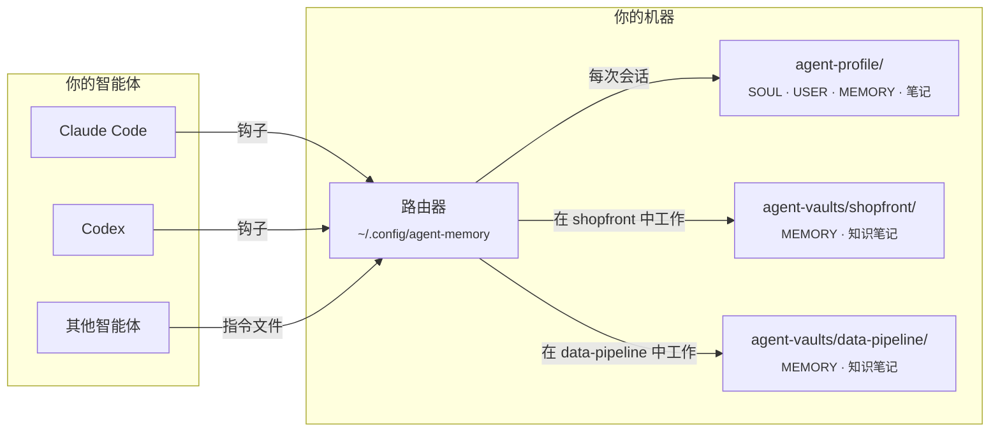
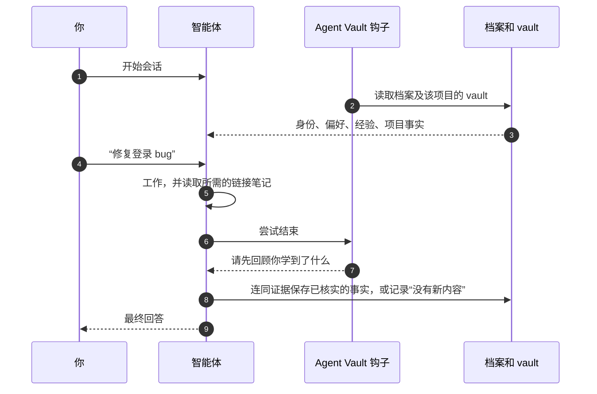

<div align="center">


# Agent Vault

**为你使用的所有编程智能体提供一份共享记忆，并为每个项目单独保存一份记忆。**

[](https://github.com/AlexMakesC0de/agent-vault/actions/workflows/tests.yml)
[](LICENSE)


[English](README.md) · **简体中文** · [Español](README.es.md) · [日本語](README.ja.md)

本文为译文，如与英文版 [README.md](README.md) 有出入，以英文版为准。

</div>

<p align="center">
  <picture>
    <source media="(prefers-color-scheme: dark)" srcset="docs/assets/viewer-dark.png">
    
  </picture>
  <br>
  <sub>只读的记忆页面，此处使用演示数据展示。</sub>
</p>

编程智能体在会话之间会忘记一切，而且每个智能体都用自己的格式记自己的笔记。Agent Vault 让 Claude Code、Codex 以及任何会读取指令文件的智能体共享**同一份记忆**：你是谁、你喜欢怎样工作、适用于所有场景的经验，以及你当前所在项目的事实。它就是你磁盘上的普通 Markdown 文件，每次修改都会保留证据和历史，任何内容都不会离开你的机器。

## 目录

- [亮点](#亮点)
- [工作原理](#工作原理)
- [快速开始](#快速开始)
- [让智能体帮你安装](#让智能体帮你安装)
- [查看你的记忆](#查看你的记忆)
- [日常命令](#日常命令)
- [项目知识](#项目知识)
- [更多设备、团队和其他智能体](#更多设备团队和其他智能体)
- [常见问题](#常见问题)
- [参与贡献](#参与贡献)
- [许可证](#许可证)

## 亮点

- **一份档案，所有智能体通用。** Claude Code 和 Codex 通过钩子（hooks）加载同一套身份、偏好和通用经验。其他智能体通过各自的指令文件使用同样的文件。
- **每个项目一个 vault。** 项目事实只在你处理该项目时加载，因此一个项目的细节不会泄漏到另一个项目。除非你选择与团队共享，vault 都存放在你的代码仓库之外。
- **精简的核心，链接的笔记。** 每个核心文件都有字符上限，保证每次会话都能完整装入。详细内容放在相互链接的主题笔记中，智能体只在任务需要时才去读取。
- **证据与历史。** 每条保存的事实都会记录来源和类型（explicit、observed 或 inferred），每次修改都会保留之前的值。基于过期版本的写入会被拒绝，不会互相覆盖。
- **可靠的回顾。** 在智能体结束工作之前，钩子会要求它回顾这次学到的内容并记录这次回顾，即使没有任何变化。
- **搜索、诊断和查看器。** 对全部记忆进行排序的全文搜索、只读的健康检查，以及一个让你一眼看清所有内容的静态页面。
- **本地运行，零依赖。** 只使用 Python 标准库。不需要运行服务器、API 密钥或数据库。

## 工作原理

你的记忆就是几个存放 Markdown 的文件夹。一个小型路由器（每台机器安装一次）决定每个智能体会话能看到什么。



档案总是会加载。当你提到某个项目或在其文件夹中工作时，对应的项目 vault 才会加载，而项目事实只保存在该 vault 中。学到的内容也沿同样的路径写回：



## 快速开始

你需要 **Python 3.11+**、**Git**，以及 Claude Code、Codex 或两者都有。在 Windows 上请安装 Git for Windows（其中包含 Git Bash），不需要 WSL。

**1. 关闭 Claude 的自动记忆**（Claude Code 用户）。它是一个独立的存储，会与 Agent Vault 相互冲突。请先[备份你的笔记并将其关闭](docs/claude-auto-memory.md)。

**2. 获取工具并创建你的档案。** 在你希望存放 `agent-vault` 和 `agent-profile` 的文件夹中运行以下命令。在 macOS 和 Linux 上使用 `python3`；如果你只用 Claude，请去掉 `--codex-hooks`。

```bash
git clone https://github.com/AlexMakesC0de/agent-vault.git
cd agent-vault
python scripts/agent-memory.py --profile ../agent-profile init-profile
python scripts/project-memory-router.py install --profile ../agent-profile --codex-hooks
```

安装会保留你现有的客户端设置，并先做好备份。它不会创建任何账号或仓库。

**3. 添加项目。** 让 `--workspace` 指向一个已有的 Git 项目，并把 `MyApp` 和 `myapp` 改成它的名字。

```bash
python scripts/setup-vault.py --vault ../agent-vaults/myapp --name MyApp
python scripts/project-memory-router.py register --id myapp --name MyApp --root ../agent-vaults/myapp --workspace /full/path/to/MyApp
```

项目仓库不会被修改。对每个项目重复以上步骤，它们都共用你的同一份档案。如果不想再使用某个 vault，运行 `project-memory-router.py unregister --id myapp`，文件会保留。

**4. 检查。** 重启你的客户端，并在它询问时信任这些钩子。在一个新的对话中提问：

> 你加载了哪个中央档案和哪个 MyApp 项目记忆？请显示它们的路径和修订版本。

然后运行健康检查，它不会修改任何内容：

```bash
python ~/.config/agent-memory/router.py doctor
```

<details>
<summary><b>各个文件存放在哪里</b></summary>

```text
Your chosen folder/
├── agent-vault/            The tools, cloned from this repository
├── agent-profile/          Your memory, created by init-profile
│   ├── SOUL.md             Who your agent is (one identity for all agents)
│   ├── USER.md             Your preferences
│   ├── MEMORY.md           Lessons that apply across projects
│   └── notes/              Detail too long for the cores, read on demand
├── agent-vaults/
│   └── myapp/
│       ├── MEMORY.md       Facts about MyApp only
│       └── docs/knowledge/ Linked topic notes
└── MyApp/                  Your project; Agent Vault adds nothing to it

~/.config/agent-memory/     Installed router, search index, viewer page
```

</details>

## 让智能体帮你安装

不想自己输入命令？在一个用于存放工具的空文件夹中，把下面这段话粘贴到 Claude Code 或 Codex 中：

```text
在这台机器上安装 Agent Vault（https://github.com/AlexMakesC0de/agent-vault）。
阅读它的 README.md，严格按照 "Quick start" 一节操作：在 Windows 上使用 python，
在其他系统上使用 python3。
- 在第 1 步之前，先告诉我 Claude 自动记忆指南会改动什么，等我同意后再继续。
- 问我要添加哪些 Git 项目以及它们的完整路径，不要猜测。
- 在添加 --codex-hooks 之前，先问我是否使用 Codex。
- 不要修改任何项目仓库。
- 最后运行 router.py doctor 并把输出给我看。
```

安装完成后，智能体就已经知道如何使用这份记忆：安装程序会把相关指令添加到你的客户端中。

## 查看你的记忆

```bash
python ~/.config/agent-memory/view.py --open
```

这条命令会把一个 HTML 页面写入 `~/.config/agent-memory/view.html` 并打开它：页面上有你的档案及其容量计量条、每个已注册的项目 vault、你的人物笔记以及最近的修改。尚未加载的推断条目会以虚线边框显示。

该页面是**只读的，不会从网络加载任何内容**。如需修改，请点击卡片上的 **Copy request**，然后把文本粘贴到与智能体的对话中，智能体会通过记忆 CLI 完成修改并保留历史。由于页面包含你的私人档案，查看器会拒绝把它写入任何 vault 或项目文件夹。

## 日常命令

这些命令你很少需要亲自运行：智能体会在会话上下文中拿到它们。列在这里是为了让你知道有哪些功能。

| 用途 | 命令 |
| --- | --- |
| 查找某项内容记录在哪里 | `python ~/.config/agent-memory/router.py search merge jobs --project myapp` |
| 检查安装和记忆的健康状况 | `python ~/.config/agent-memory/router.py doctor --fetch` |
| 以页面形式查看你的记忆 | `python ~/.config/agent-memory/view.py --open` |
| 打印一次会话会加载的内容 | `python ~/.config/agent-memory/router.py context --prompt MyApp` |
| 列出已注册的项目 | `python ~/.config/agent-memory/router.py list` |
| 保存一条事实（附带证据和当前修订版本） | `python ~/.config/agent-memory/agent-memory.py --root PATH update --help` |
| 检查项目的链接笔记 | `python ~/.config/agent-memory/agent-memory.py --root PATH check-knowledge` |

[全部记忆命令](docs/maintenance.md)

## 项目知识

项目 vault 分为两层。`MEMORY.md` 是每次会话都会加载的精简核心，用于几乎适用于所有任务的规则。其余内容都以主题笔记的形式放在 `docs/knowledge/` 中：每篇笔记一个主题，按领域地图分组，相互提及时彼此链接。智能体从地图出发，只打开任务需要的笔记，因此即使项目不断增长，每次会话的开销也保持不变。

要为项目构建笔记，请让你的智能体使用 **vault-knowledge** 技能。它会梳理仓库、编写地图、填写笔记，并用 `check-knowledge` 校验每个链接。当某个 vault 的笔记少于五篇时，会话上下文会提醒智能体主动提出这项工作。

[Obsidian](https://obsidian.md) 是可选的：把你的档案和每个 vault 分别作为独立的 Obsidian vault 打开，即可浏览链接。智能体直接读取 Markdown，所以不需要运行 Obsidian。

## 更多设备、团队和其他智能体

- **另一台设备。** 记忆不会自动同步。把你的档案放进你自己的私有 Git 仓库，每个 vault 也各自作为一个仓库，然后按照[设备指南](docs/devices.md)操作。
- **整个团队共用的 vault。** 使用 `setup-vault.py --root /path/to/MyApp --name MyApp` 把 vault 放进项目仓库（如使用 Codex，请加上 `--codex-hooks`），注册时不要带 `--workspace`。这样会把记忆脚本、钩子和笔记提交到仓库中，每个克隆该仓库的人都会加载它们。
- **其他智能体。** 任何会读取指令文件并能运行 shell 命令的智能体都可以使用同一份记忆：把它的文件传给 `install --instructions PATH` 即可。
- **旧版 vault。** 如果项目中有由早期版本生成的 `SOUL.md`，需要先进行[迁移](docs/migration.md)。

## 常见问题

<details>
<summary><b>我的记忆会离开我的机器吗？</b></summary>

不会。这些工具只读写本地文件，自身不发起任何网络请求；唯一的例外是 `doctor --fetch`，它会在工具包的克隆目录中运行 `git fetch`。你使用的智能体会看到提供给它们的记忆，和任何指令文件一样，所以不要把机密信息和客户数据放进去。
</details>

<details>
<summary><b>为什么核心文件有大小限制？</b></summary>

你的档案和当前项目的核心会通过一条钩子消息发送给智能体，而 Claude Code 将这条消息限制在 10,000 个字符以内。各项上限（SOUL 1,500、USER 2,000、MEMORY 2,200）保证两者都能装进去。达到 85% 时工具会发出警告，让你在保存被拒绝之前就把细节移到链接笔记中。
</details>

<details>
<summary><b>为什么用 Markdown 文件而不是数据库？</b></summary>

你可以在拉取请求中阅读、比较和审查每一处修改，这些文件比任何工具都更长久，历史检查也建立在它们之上。搜索使用一个从 Markdown 重建的 SQLite 索引，因此删除它始终是安全的。
</details>

<details>
<summary><b>它会取代 Claude 自带的记忆吗？</b></summary>

会，如果你希望只有一个可信来源的话。请[关闭 Claude 的自动记忆](docs/claude-auto-memory.md)，避免两者相互冲突。`CLAUDE.md` 文件仍然照常工作。
</details>

<details>
<summary><b>如果智能体保存了错误的内容怎么办？</b></summary>

每次修改都会在存储的历史中保留之前的值，条目只会被停用，永远不会被抹除。你可以让智能体更正或停用该条目，也可以自己使用记忆 CLI。
</details>

## 文档

[记忆命令](docs/maintenance.md) · [设备指南](docs/devices.md) · [迁移](docs/migration.md) · [架构与恢复](docs/architecture.md) · [Claude 自动记忆](docs/claude-auto-memory.md)

## 参与贡献

欢迎提交缺陷报告、想法和拉取请求。请阅读 [CONTRIBUTING.md](CONTRIBUTING.md)，了解开发环境配置、测试套件以及每次修改都要遵守的几条规则。如需报告安全问题，请按照 [SECURITY.md](SECURITY.md) 操作，不要直接创建 issue。

## 致谢

身份、用户偏好和记忆三者分离的设计受到 [Hermes](https://github.com/NousResearch/hermes-agent) 的启发。没有复制任何上游代码。

## 许可证

[MIT](LICENSE)
